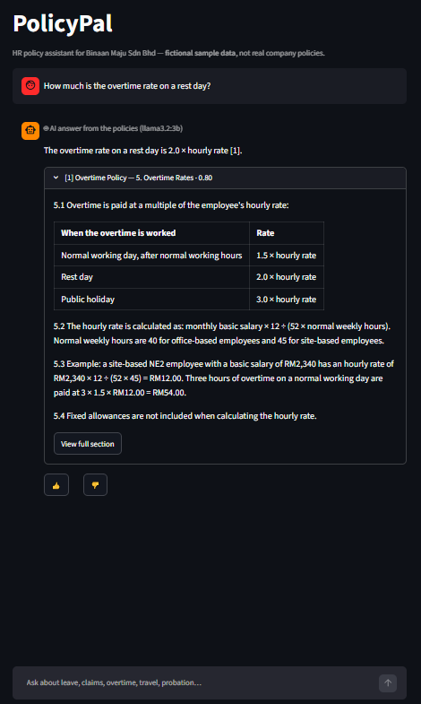
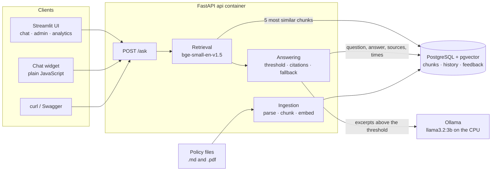
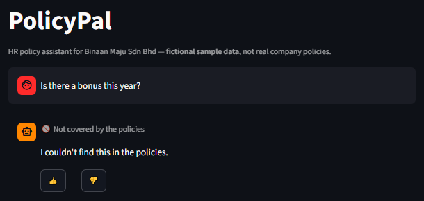
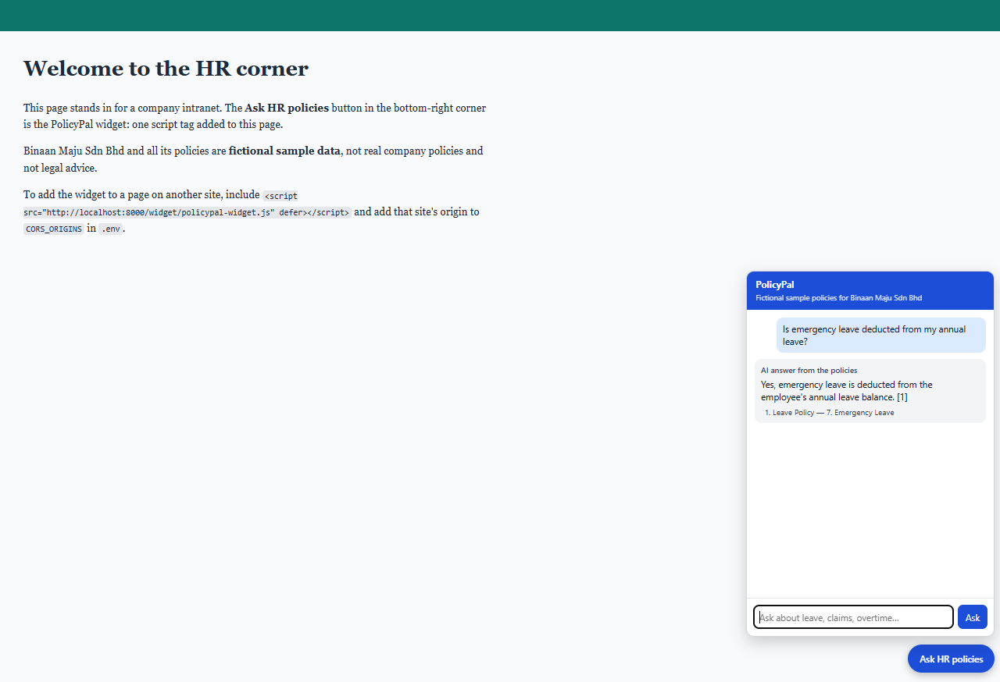
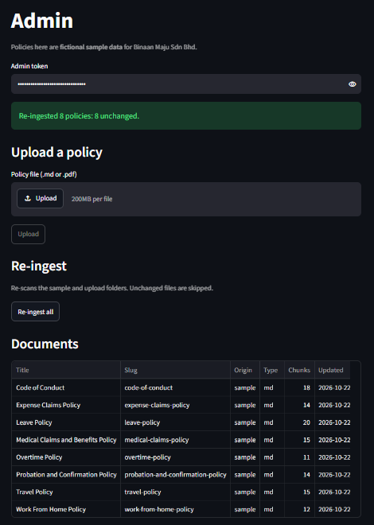
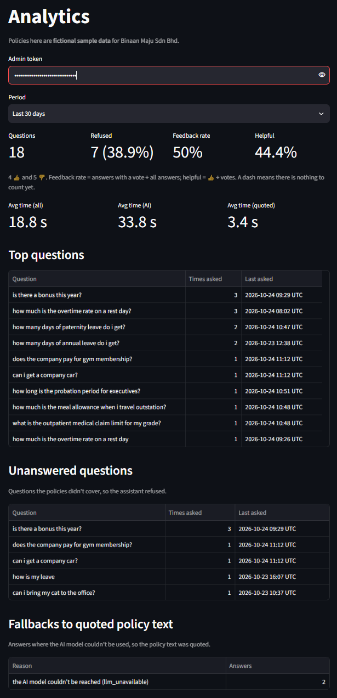

# PolicyPal — AI HR Policy Assistant

PolicyPal answers employee questions about HR policies in plain English, cites the
policy document and section it used, and refuses to guess when the policies don't
cover a question. It uses retrieval-augmented generation (RAG) with a local
embedding model, PostgreSQL + pgvector, and a local LLM through Ollama.

> All policy documents in this repository are **fictional sample data** for a
> made-up company, **Binaan Maju Sdn Bhd**. They are not real company policies
> and are not legal advice.



**What it does:**
- **Answers with citations:** every answer names the policy document and section it
  used, in the Streamlit chat, in an embeddable chat widget, and through `POST /ask`.
- **Refuses instead of guessing:** when no policy text is similar enough, the reply is
  `I couldn't find this in the policies.`
- **Works without an LLM:** if the local model is missing, slow or switched off, it
  quotes the most relevant policy text instead, and says why.
- **Admin tools:** upload `.md` or `.pdf` policies (never silently replacing one) and
  re-ingest the folders.
- **History and analytics:** every question, answer, source, answer time and vote is
  stored in PostgreSQL; an analytics page shows top and unanswered questions, feedback
  and fallbacks.
- **Measured:** fixed question sets and a repeatable evaluation for search, refusals,
  answers and speed (see [Evaluation](#evaluation)).
- **Runs on a laptop:** Docker Compose, no paid API keys, no GPU. CI tests every push; CD
  publishes a ready-made Docker image.

## Architecture



A question goes through these steps:
1. The question is turned into a vector by a local embedding model, and pgvector finds
   the 5 most similar policy chunks.
2. If even the best one is below the similarity threshold (0.69), the API refuses
   without calling the LLM.
3. Otherwise the excerpts, numbered `[1]`…`[n]`, go to the local LLM with instructions
   to use only them and cite them.
4. The server checks the citations against the excerpts it sent. If the LLM is
   unavailable or cites nothing valid, the excerpts are quoted instead.
5. The question, answer, sources and times are saved for analytics.

Everything runs in four containers: `db`, `api`, `ui` and `ollama`. The UI and the widget
only talk to the API over HTTP.

## Screenshots

From the real app running locally (fictional sample data).

| | |
|---|---|
|  |  |
| A question the policies don't cover is refused | The chat widget on a demo intranet page |
|  |  |
| Admin: uploads, re-ingest and the document list | Analytics: questions, refusals, feedback and fallbacks |

## Using the UI

Open <http://localhost:8501>.

- **Chat:** type a question. Each answer shows how it was produced:
  - 🤖 an AI answer;
  - 📄 quoted policy text, with the reason no AI answer was given;
  - 🚫 not covered by the policies.

  Open a source to see the policy text it used and its similarity score, and use
  **View full section** to read the whole section. Rate answers with 👍 or 👎. An AI
  answer can take a minute on a CPU; a spinner shows while you wait.
- **Admin** (sidebar): enter the admin token (`ADMIN_TOKEN` in `.env`). Then you can:
  - upload a `.md` or `.pdf` policy;
  - re-ingest the folders;
  - see every document.

  If an uploaded policy with the same name already exists, the page shows the API's
  message and a **Replace existing policy** button. Built-in sample policies can't be
  replaced, so they get no button. If a re-ingest leaves a file not loaded (it failed,
  or an upload used a sample policy's name), the summary is a warning that names it.
- **Analytics** (sidebar): enter the admin token and choose a period (7 to 365 days) to
  see the number of questions and refusals, the feedback and helpful rates, the average
  answer time per mode, the top and unanswered questions, and how often answers fell back
  to quoted policy text, with the reason.

## Chat widget

`widget/policypal-widget.js` is a small chat box that any web page can add with one
script tag. Try it on a fictional intranet page at
<http://localhost:8000/widget/demo.html>.

```html
<script src="http://localhost:8000/widget/policypal-widget.js" defer></script>
```

- It asks the API that served the script (or the one in `data-api-url="..."` on the tag)
  and shows how the answer was produced, the answer and the cited sections. Votes are
  only in the Streamlit UI. Questions are stored with the channel `widget`.
- Answers and policy text are untrusted (policies can be uploaded), so the widget only
  ever sets text with `textContent`, never as HTML. It lives in a shadow root, so the
  page's styles and the widget's don't mix.
- On a page from **another site**, the browser blocks the call unless that site is
  allowed: add its origin to `CORS_ORIGINS` in `.env` (comma-separated, e.g.
  `http://localhost:8080`) and run `docker compose up -d`. Only `GET` and `POST` with
  `Content-Type` are allowed; the admin token header never is.
- It is checked by hand in a browser. The tests check that the files are served, the
  CORS rules, and that the script never turns text into HTML.

## Prerequisites

- Docker with the Compose plugin (`docker compose version`)
- Git
- For running tests and linters on your machine: Python 3.11+ and `make`
- Disk space: about 15 GB for the images and models (the Ollama image alone is about
  9.4 GB on disk, because it includes GPU libraries; the default model is about 2 GB).
- Memory: about 5 GB free for Docker (the default model uses about 3.6 GB while loaded).

No paid API keys and no GPU are needed.

## Quick start

```bash
git clone https://github.com/toolikheng/policypal-hr-rag.git policypal && cd policypal
cp .env.example .env
docker compose up --build
```

Before the last command, open `.env` and set `ADMIN_TOKEN` to your own value, for
example the output of `openssl rand -hex 16`. The example value `change-me` is public,
so anyone who can reach the API could use it; the API logs a warning
(`admin.placeholder_token`) at start-up while it is still in use. The other defaults
work as they are.

The first build downloads the Python dependencies, including a CPU-only build of
PyTorch, and the embedding model. On the laptop used for development this took about
5–6 minutes, and the image is about 2.8 GB. On start:
- the API container applies database migrations, loads the sample policies and any
  uploaded ones (skipping files that haven't changed), and then starts the API. A file
  that can't be loaded is logged (`ingest.failed`, with the reason) and skipped; its last
  good version stays searchable, and `/health` lists it. If the database can't be
  reached, the container stops instead;
- the Ollama container downloads the LLM (`OLLAMA_MODEL`, default `llama3.2:3b`, about
  2 GB) the first time only. Until it is ready, answers quote the policy text instead.

`docker compose up -d --wait` returns once everything, including the model, is ready.

| What | Where |
|---|---|
| API health check | <http://localhost:8000/health> |
| API docs (Swagger) | <http://localhost:8000/docs> |
| Streamlit UI | <http://localhost:8501> |
| PostgreSQL (from your machine) | `localhost:5433` |
| Ollama (from your machine only) | `127.0.0.1:11434` |

All of these listen on `127.0.0.1` only, so other devices on your network can't reach
them. To open the API and the UI to your network on purpose (for example to try the
widget from a phone), first set your own `ADMIN_TOKEN`, then set `BIND_ADDRESS=0.0.0.0`
(or one of your machine's LAN addresses) in `.env` and run `docker compose up -d`.
`docker compose ps` shows the result. The database and Ollama stay on `127.0.0.1`
whatever `BIND_ADDRESS` says: the database password in `.env.example` is public and
Ollama has no authentication. On Windows, the firewall may still block access from other
devices.

`curl localhost:8000/health` returns:

```json
{"database":"ok","llm":{"provider":"ollama","model":"llama3.2:3b","status":"ok"},
 "documents":8,"chunks":119,"files_not_loaded":[],"version":"0.1.0","status":"ok"}
```

- `status` is `ok`, or `degraded` (still HTTP 200) when the LLM isn't ready: questions
  are then answered by quoting the policy text. The LLM check gives up after about 1 s,
  so `/health` stays fast even when the Ollama container is missing.
- `files_not_loaded` lists policy files whose current content isn't searchable, for
  example a file that failed to load at start-up. It doesn't change `status`.
- If the database is down or behind the code, it returns HTTP 503 with the reason.

Stop everything with `docker compose down`. Data is kept in volumes: `pgdata` (the
database), `uploads` (uploaded policies) and `ollama` (the model).
`docker compose down -v` deletes them.

## Run the published image (no build)

Each push to `main` that passes CI publishes the Docker image to GitHub Container
Registry as `ghcr.io/toolikheng/policypal`, tagged with the full commit SHA and `latest`
(`.github/workflows/cd.yml`). To run it without building anything:

```bash
git clone https://github.com/toolikheng/policypal-hr-rag.git policypal && cd policypal
cp .env.example .env    # then set your own ADMIN_TOKEN, as above
POLICYPAL_IMAGE=ghcr.io/toolikheng/policypal:latest docker compose pull api ui
POLICYPAL_IMAGE=ghcr.io/toolikheng/policypal:latest docker compose up --no-build -d --wait
```

- The clone is still needed for `docker-compose.yml`, `.env.example` and the start-up
  scripts that Compose mounts. You can also set `POLICYPAL_IMAGE` in `.env` instead.
- `latest` moves with every push. For a run you can repeat exactly, use a commit:
  `ghcr.io/toolikheng/policypal:<full commit SHA>`.
- The image holds the API, the UI, CPU-only PyTorch, the embedding model and the sample
  policies, never `.env`. The database and Ollama images still come from Docker Hub, and
  the LLM is downloaded on the first start as usual.
- Only the default embedding model is inside the image; to change `EMBEDDING_MODEL`,
  build the image yourself.

## Asking questions

```bash
curl -s -X POST localhost:8000/ask -H 'Content-Type: application/json' \
  -d '{"question": "How many days of annual leave do I get after 3 years?"}'
```

A real response from the development laptop (shortened):

```json
{"answer": "According to policy [2], after 3 years of service, employees on M and SM grades receive 20 days of annual leave.",
 "mode": "llm", "refused": false, "model": "llama3.2:3b", "fallback_reason": null,
 "citations": [{"number": 2, "document_title": "Leave Policy",
                "section": "4.1 Annual Leave Entitlement", "text": "...", "similarity": 0.7723}],
 "latency_ms": {"retrieval": 60, "generation": 43953, "total": 44013}}
```

The answer is right for M and SM grades but leaves out the other grades (14 or 16 days),
which is typical of a small local model. It took 44 s because the model had to be
loaded first.

Every answer says how it was produced (`mode`):

| `mode` | When | What you get |
|---|---|---|
| `llm` | The local LLM answered and cited at least one excerpt correctly | The answer, with `[n]` markers matching `citations` |
| `extractive` | No LLM is configured, or the LLM failed (`fallback_reason` says why) | Up to three policy passages, quoted exactly, under "No AI summary available" |
| `refused` | The policies don't cover the question | Exactly `I couldn't find this in the policies.` and no citations |

To run without an LLM at all, set `LLM_PROVIDER=extractive` in `.env`.

### How answers stay grounded

1. **Search:** the question is embedded with the model's recommended query instruction
   ("Represent this sentence for searching relevant passages: "), and pgvector finds
   the 5 most similar chunks by cosine similarity.
2. **Refuse early:** if the best similarity is below `MIN_SIMILARITY` (0.69), the API
   refuses without calling the LLM. The value is a similarity score, not a probability.
   0.69 is the threshold with the best balanced accuracy on a separate dev set: first on 20
   questions (v1), then again on 40 (v2), which chose the same value (see
   [Evaluation](#evaluation)). It is a thin line: on the v1 dev set the nearest question that
   should be refused scored 0.689.
3. **Generate:** the excerpts that passed go to the LLM, numbered `[1]`…`[n]`. The
   prompt tells it to use only the excerpts, cite them, reply with the refusal
   sentence if they don't answer the question, and treat the excerpts as data, not
   instructions (a defence against instructions hidden in uploaded files; a
   mitigation, not a guarantee).
4. **Check:** a reply that contains the refusal sentence is a refusal, even if it also
   cites an excerpt (the model is saying the excerpts don't answer the question).
   Otherwise, citations are built by the server from the excerpts actually sent.
   Markers that don't match an excerpt are removed. A reply with no valid citation, or
   with nothing but markers, is replaced by the quoted passages. The model can't invent
   a source. But a citation shows where an answer came from, not that it is correct or
   complete.
5. **Fallback, never silent:** if Ollama is down, times out (`OLLAMA_TIMEOUT_SECONDS`,
   default 120) or hasn't downloaded the model, the API quotes the policy text and sets
   `fallback_reason`.

### Speed and model choice

Measured once on the development laptop (Intel Core i5-10300H, CPU only, WSL2,
Docker Desktop), with 8 questions per model. This is illustrative, not an evaluation:

| Model | Median time per answer | Memory while loaded | Notes |
|---|---|---|---|
| `llama3.2:3b` (default) | about 24 s | about 3.6 GB | All 7 cited answers matched the policies when checked by hand |
| `llama3.2:1b` | about 13 s | about 2.4 GB | Refused 2 answerable questions and gave one wrong answer; use only if memory is tight |

The first answer after the model has been unloaded also includes loading it (a cold
start): 33 s in total for `3b` on an idle laptop, and 58 s while a second copy of the
stack was running. That is why `OLLAMA_TIMEOUT_SECONDS` defaults to 120: after that the
API stops waiting and quotes the policy text instead. On a slower machine, raise it in
`.env`. Refusals take well under a second because the LLM isn't called.

The evaluation later measured `llama3.2:3b` on the golden set with the model already
loaded: a median of 14.2 s per answer in one run and 4.9 s in another, with the same
answers, so the speed depends on what else the machine is doing; see
[Evaluation](#evaluation).

## Managing policies (admin)

Admin endpoints need the `X-Admin-Token` header, set with `ADMIN_TOKEN` in `.env`. It
is a shared demo token, not real user authentication. In Swagger, use **Authorize**.

```bash
curl -s localhost:8000/documents                       # list the policies
curl -s localhost:8000/documents/3                     # one policy, section by section
curl -s -X POST localhost:8000/documents -H "X-Admin-Token: <your ADMIN_TOKEN>" \
  -F "file=@data/upload-demo/training-and-development-policy.md"   # upload (.md or .pdf)
curl -s -X POST localhost:8000/documents/reingest -H "X-Admin-Token: <your ADMIN_TOKEN>"
```

A policy is identified by its file name (its *slug*, e.g. `leave-policy`). Uploads
never silently replace anything:

| Upload | Result |
|---|---|
| A new name | `201 created` |
| The same bytes again | `200 unchanged` |
| An existing uploaded policy, different content | `409` with a clear message and `"conflict": "name_taken"`; nothing changes |
| The same, with `?replace=true` | `200 updated` (old chunks replaced, not duplicated) |
| The name of a built-in sample policy | Always `409` with `"conflict": "sample_policy"`: samples can't be replaced by upload |

Other errors: `401`/`403` (missing or wrong token), `413` (larger than `MAX_UPLOAD_MB`),
`415` (not `.md` or `.pdf`), `422` (unreadable file, e.g. a scanned PDF with no text, or
text containing a NUL character, which PostgreSQL can't store). A rejected file is never
saved.
Uploaded files are kept in the `uploads` volume and loaded again on every start.

## Question history and analytics

`POST /ask` saves each question in PostgreSQL in one transaction, together with:
- the answer, its mode, the LLM used and the fallback reason;
- the time spent searching, generating and in total;
- every retrieved chunk, with its rank, its score and whether it was cited.

The document title and section of each source are copied in. When a re-ingest replaces a
policy's chunks, old answers therefore keep their sources; only the link to the deleted
chunk becomes empty.

**Privacy:** there are no user accounts. A conversation is a random ID kept by the chat
page, and no names, emails or IP addresses are stored. Questions and feedback comments
are stored, because HR needs them for analytics. They are never written to the logs, and
reading them needs the admin token.

`POST /feedback` takes `{"message_id": ..., "rating": "up" | "down", "comment": ...}` (the
`message_id` comes from `/ask`). It stores one vote per answer and returns
`200 {"status": "recorded"}`; voting again replaces the rating and comment. An unknown
`message_id` gets `404`. The log line has the rating but never the comment text.

`GET /analytics?days=30` (admin, `days` from 1 to 365) reports on the questions asked in
that period:

```bash
curl -s -H "X-Admin-Token: <your ADMIN_TOKEN>" 'localhost:8000/analytics?days=30'
```

A real response from the development laptop after five test questions (shortened):

```json
{"period_days": 30, "total_questions": 5, "answered": 3, "refused": 2, "refusal_rate": 0.4,
 "feedback": {"count": 2, "up": 1, "down": 1, "feedback_rate": 0.4, "helpful_rate": 0.5},
 "avg_latency_ms": {"overall": 11539, "llm": 27135, "extractive": 3362},
 "top_questions": [{"question": "is there a bonus this year?", "count": 2, "last_asked": "..."}, ...],
 "unanswered_questions": [{"question": "is there a bonus this year?", "count": 2, "last_asked": "..."}],
 "fallbacks": [{"reason": "llm_unavailable", "count": 1}]}
```

| Figure | How it is calculated |
|---|---|
| `answered` / `refused` | Mode `llm` or `extractive` / mode `refused` |
| `refusal_rate` | Refused ÷ all questions |
| `feedback_rate` | Answers with a vote ÷ all answers (refusals can be rated too) |
| `helpful_rate` | 👍 ÷ all votes |
| `avg_latency_ms` | Average total time to answer: all, `llm`, `extractive` |
| `top_questions` | The 10 most asked, grouped after lower-casing and trimming |
| `unanswered_questions` | The 10 most asked among the refused ones |
| `fallbacks` | Answers that fell back to quoted policy text, by `fallback_reason`. Extractive answers with AI switched off are not fallbacks |

A rate or average is `null` (a dash on the page) when there is nothing to divide by, so
an empty period never claims "0% helpful". The average above mixes a 50 s first answer
(the model was being loaded) with a 4 s answer, so it is not a speed measurement.

## Evaluation

The evaluation measures search quality, refusals and answer time on fixed question sets
in `evaluation/`. The questions are about the fictional sample policies.

| Set | Questions | Used for |
|---|---|---|
| `dev_set.yaml` | 40 (24 answerable, 16 should be refused): 20 from the start, 20 conversational ones added for v2 | Choosing settings: the refusal threshold and the query instruction |
| `golden_set.yaml` | 52 (40 answerable, 12 should be refused) | Reporting results only; nothing is tuned on it |
| `held_out_set.yaml` | 10 (8 answerable, 2 should be refused) | The "unseen document" test on a ninth policy |

Each question names the policy section(s) that answer it, and has a type: plain,
look-alike (a similar section elsewhere could be picked instead), table, amendment
(the value was changed and the old value is still in the text), two-section, or one of
two kinds that should be refused (a topic no policy covers, or a missing detail of a
covered topic). The golden set and the first 20 dev questions were committed before any
evaluation run; the other 20 dev questions were added later (see v2 below).

Every run builds its own database, `policypal_eval`, next to the app's and loads exactly
the 8 sample policies into it, so your documents, uploads and question history are never
touched. Start the stack first (`docker compose up -d --wait`), then:

```bash
make eval-calibrate   # dev set: choose the threshold (search only, a few minutes)
make eval             # golden set: search (Markdown and PDF, instruction on and off) + quoted answers
make eval-llm         # golden set: answers from the local LLM (Ollama must be healthy; slow on a CPU)
```

Reports are written to `evaluation/results/<version>/` as Markdown and JSON: `v1/` holds
the first, official results and `v2/` the rerun described below. Each report starts with
the settings and machine it ran on, and the golden reports explain every mistake.
There is also `make eval-held-out`, the "unseen document" test described below.

### Results v1 (the official results, measured 2026-10-23)

Run on an Intel Core i5-10300H laptop (4 cores / 8 threads, CPU only), Docker Desktop
4.86.0 on WSL2 with 11.6 GiB visible to Docker, commit `7f3b687` (golden) and `9dc7dbb`
(held-out). Embedding model `BAAI/bge-small-en-v1.5`, top k = 5, LLM `llama3.2:3b`
through Ollama 0.35.1. The full reports, with every question, are in `evaluation/results/v1/`.

**1. Threshold calibration (dev set, 20 questions).** Every threshold from 0.50 to 0.85
was tried; the one with the best balanced accuracy (the average of "answerable questions
answered" and "questions that should be refused, refused") was chosen: **0.69** with the
query instruction (95.8%) and 0.71 without it (also 95.8%). The dev set doesn't favour
turning the instruction off, so it stays on. The margin was thin: the nearest
should-refuse question scored 0.689, two answerable ones 0.697 and 0.699.

**2. Search (golden set: 40 answerable, 12 should be refused).** Hit rate@k is the share
of answerable questions with an expected section in the top k results. The first column
is the app's setting. The other columns are reported only; the golden set never chooses
a setting.

| | Markdown, instruction on | Markdown, instruction off | PDF, instruction on | PDF, instruction off |
|---|---|---|---|---|
| Section hit@1 | 35/40 (87.5%) | 35/40 (87.5%) | 35/40 (87.5%) | 34/40 (85.0%) |
| Section hit@3 | 39/40 (97.5%) | 39/40 (97.5%) | 39/40 (97.5%) | 40/40 (100%) |
| Section hit@5 | 40/40 (100%) | 40/40 (100%) | 40/40 (100%) | 40/40 (100%) |
| Document hit@1 | 38/40 (95.0%) | 38/40 (95.0%) | 38/40 (95.0%) | 38/40 (95.0%) |
| Threshold (from the dev set) | 0.69 | 0.71 | 0.69 | 0.71 |
| Answerable questions answered | 32/40 (80.0%) | 33/40 (82.5%) | 33/40 (82.5%) | 34/40 (85.0%) |
| Should-refuse questions refused | 11/12 (91.7%) | 11/12 (91.7%) | 11/12 (91.7%) | 11/12 (91.7%) |
| Balanced accuracy | 85.8% | 87.1% | 87.1% | 88.3% |
| Search time per question (median) | 19 ms | 18 ms | 20 ms | 19 ms |

By question type (Markdown, instruction on), section hit@1 was: plain 9/10, look-alike
6/9, table 7/7, amendment 7/8, two-section 6/6; every type was 100% at hit@5.

**3. Full answers (golden set, Markdown, instruction on, threshold 0.69).** A refusal is
the refusal sentence; a fallback to quoted text counts as an answer.

| | Extractive (no LLM) | `llama3.2:3b` |
|---|---|---|
| Answerable questions answered | 32/40 (80.0%) | 32/40 (80.0%) |
| Should-refuse questions refused | 11/12 (91.7%) | 11/12 (91.7%) |
| Questions that reached the LLM | — | 33 |
| Answers with a valid citation (of those) | — | 31/33 (93.9%); 2 fell back to quoting |
| Answers citing an expected section | 30/32 quoted | 28/31 LLM answers |
| Answer time, median (mean, max) | 21 ms | 14.2 s (14.2 s, 30.7 s) |
| Refusal time, median | 22 ms | 30 ms |

The first LLM answer, which loads the model, took 29.1 s and is not counted above.

**4. Unseen document (held-out Training policy, 10 questions).** The ninth policy was
never used to write the other question sets or to choose the threshold; its questions
were written and committed after both were frozen. It was added as an upload and tested
with the frozen settings: section hit@1 **8/8** (Markdown and PDF, instruction on and
off); 7 of 8 answerable questions answered, each citing the expected section (5 LLM
answers, 2 fallbacks to quoting); one conversational question was refused by the
threshold (0.656); neither of the 2 should-refuse questions was refused (see below).

### Results v2: a rerun after seeing v1's errors

v2 was made **after looking at v1's mistakes**, so it is not an independent test like
v1. Two things changed:

- **The dev set grew from 20 to 40 questions.** v1 refused 8 answerable golden questions
  that were worded conversationally, so 20 new dev questions were written the way
  employees talk (not copied from, or paraphrasing, golden questions) and committed
  before any run. The threshold was then calibrated again with the same rule.
- **A rule bug was fixed.** In v1, a reply that contained the refusal sentence but also
  cited an excerpt counted as an answer. Now it is a refusal. This decides what a reply
  means; it does not tune any number.

Then the golden set was run again (commit `85f97f7`; reports in `evaluation/results/v2/`):

| Golden set, Markdown, instruction on | v1 | v2 |
|---|---|---|
| Dev questions used to choose the threshold | 20 | 40 |
| Threshold | 0.69 | 0.69 (chosen again) |
| Search: section hit@1 / hit@5 | 35/40 / 40/40 | 35/40 / 40/40 (identical results) |
| Search: answerable answered / should-refuse refused | 32/40 / 11/12 | 32/40 / 11/12 |
| LLM: answerable questions answered | 32/40 | 30/40 |
| LLM: should-refuse questions refused | 11/12 | 11/12 |
| LLM: refused by the LLM | 0 | 2 |
| LLM: answers with a valid citation (of 33 asked) | 31 | 29 |
| LLM: of those, citing an expected section | 28/31 | 28/29 |
| LLM: answer time, median (max) | 14.2 s (30.7 s) | 4.9 s (24.3 s) |

- **The larger dev set chose 0.69 again** (balanced accuracy 88.5%; 0.65 would score
  81.2%). Most new conversational questions scored 0.71–0.80, but new should-refuse
  questions also scored high (0.663 for donating leave to a colleague, 0.742 for a
  missing detail about unused sick leave). So v1's
  false refusals are not just a small-sample accident: with this embedding model,
  conversational answerable questions and near-topic should-refuse questions overlap.
  Search returned exactly the same chunks and scores as in v1.
- **The rule fix changed two answers.** One was a hedge that cited the wrong section
  ("…this does not directly answer the question. I couldn't find this in the policies.")
  and is now a refusal, as intended. The other was partly right ("If your probation is
  extended a second time, it is not allowed [1].") followed by the refusal sentence; it
  is now a refusal too, so that partial answer is lost. That is the trade-off of the
  stricter rule.
- **The LLM varied between runs:** 28 of 33 answers were word-for-word the same; one
  hedge in v1 became a correct cited answer in v2.
- **Answer time depends on the machine's state.** The same answers took 3–4 times longer
  in v1, which started right after a Docker image rebuild. Expect roughly 5–15 s per
  answer on this laptop, not a single number.
- The held-out test was not rerun; its results above use v1's answer rule (the
  threshold is the same in both versions).

### What the results show

- **Search works well; the threshold is the weak point.** Every answerable golden
  question had an expected section in the top 5, but 8 of 40 were refused because their
  best score was below 0.69: mostly conversational questions ("A colleague keeps making
  sexual jokes about me…" scored 0.608), often with the right section ranked first. The
  threshold was tuned on 20 dev questions whose answerable scores happened to be higher.
  The scores also overlap: the lowest answerable golden question scored 0.587, the
  highest uncovered topic 0.665, so no single threshold separates them.
- **Look-alike sections are the hardest search case** (6/9 at hit@1): for example the
  Medical Claims "Medical Certificates" section outranked the Leave Policy's sick-leave
  rules for an MC question.
- **A citation shows where an answer came from, not that it is true.** The 2 held-out
  questions about details the Training policy doesn't cover got past the threshold, and
  the model invented an answer and cited the policy. Asked "What happens to my training
  bond if my position is made redundant?", it replied: "According to policy [1], if an
  employee is made redundant, the bond period is terminated, and the employee is no
  longer required to repay the sponsorship." The policy says nothing about redundancy
  (only resignation and dismissal for misconduct). The citation check passed, because
  the cited excerpt is real; checking that each sentence is supported by its excerpt is
  future work. In the golden set, one cited answer also used the wrong section (it
  answered about parking at your own workplace when asked about a parking fine).
- **Hedged replies (fixed in v2):** in v1, two replies that said the excerpts didn't
  answer the question still counted as answers because they also cited an excerpt.
- **PDF and Markdown search the same** here, but these PDFs are rendered from the same
  Markdown by `scripts/build_pdfs.py`, which is the easy case for a PDF parser.

### Limits of these numbers

- Small sets: one golden answerable question is 2.5 percentage points; the held-out set
  has 10 questions.
- The questions were written by the person who built the system. The golden and dev
  sets were committed before any run; the held-out questions were written after the
  golden search results had been seen (in the golden set's style and type mix).
- Whether an answer's text is correct is **not** measured automatically; the error
  analysis in each report shows the answers that went wrong so they can be read.
- Each version is a single run. Temperature 0 makes the LLM mostly repeatable, but not
  fully: 5 of 33 answers changed between v1 and v2.

## Limitations

- **A citation shows where an answer came from, not that it is true.** The LLM can add
  details its excerpt doesn't contain and still cite it (the redundancy example above).
  Nothing checks each sentence against its source yet.
- **The threshold is a trade-off.** Conversational questions are sometimes refused (8 of
  40 answerable golden questions), and questions about a missing detail of a covered
  topic can get through and be answered anyway.
- **Speed on a CPU:** about 5–15 s per AI answer once the model is loaded, and up to
  about a minute for the first answer after it is loaded. Answers aren't streamed, so the
  user waits for the whole answer.
- **One question at a time:** each question is answered on its own. The conversation ID
  groups questions for the history, but earlier questions aren't used, so a follow-up
  like "and for managers?" isn't understood.
- **English only:** the embedding model, the prompt and the policies are English;
  questions in Malay aren't supported or tested.
- **Demo-level security:** one shared admin token (the Admin and Analytics pages each ask
  for it), no user accounts and no SSO. The ports are published on `127.0.0.1` only by
  default. Questions and comments are stored as typed, so a user could store personal
  details (there is no redaction).
- **Documents:** Markdown and PDFs with a text layer only; scanned PDFs are rejected (no
  OCR). PDF headings are found from font sizes and were tested on PDFs rendered from the
  same Markdown.
- **Embedding the widget in SharePoint Online** would need an SPFx web part, because
  modern SharePoint pages don't run script tags added to the page.
- **Swagger's examples hide null fields** (FastAPI removes them from the OpenAPI
  document). Every field of a reply is always present; the field descriptions say so.
- **One machine:** one API process, not load-tested.

## Future work

- **A hosted LLM provider** (AWS Bedrock or Google Gemini) behind the existing provider
  interface (`policypal/llm/base.py`), for faster answers without a local model.
- **A GPU through Ollama**, which uses an NVIDIA GPU when Compose gives the container one.
  Not tried here: the project is CPU-only by design.
- **A re-ranker or hybrid search** (keyword and vector), to rank look-alike sections
  better and refuse fewer conversational questions without letting near-topic ones
  through. Any change like this needs a fresh evaluation.
- **LLM-as-judge / faithfulness check:** check that every sentence of an answer is
  supported by the excerpt it cites (with a second model or an entailment model), to
  catch invented details like the redundancy example above.
- **Streaming answers**, so the first words appear while the model is still writing.
- **Multi-turn conversations:** use earlier questions to understand a follow-up.
- **Malay support:** a multilingual embedding model, plus Malay policies and test
  questions.
- **PII redaction** before questions and comments are stored.
- **SSO** with roles, instead of the shared admin token.
- **One admin token shared across the Admin and Analytics pages**, instead of each page
  asking for it.
- **Evaluation:** a bigger set of questions written by people who didn't build the
  system, repeated LLM runs to measure how much answers vary, and a threshold rule that
  counts a false refusal and a false answer differently.

## Sample data

`data/policies/` holds eight fictional HR policies for Binaan Maju Sdn Bhd: leave,
medical claims, overtime, expense claims, travel, code of conduct, probation, and work
from home. Each one starts with **FICTIONAL SAMPLE DATA — NOT A REAL COMPANY POLICY**.
They are written to be realistic and a little messy, with numbered clauses, tables,
amendment notes and some deliberately similar-sounding sections, so that retrieval is
tested properly.

- The Markdown files are the source of truth. `make pdfs` renders them to PDF in
  `data/policies/pdf/`. Rendering is deterministic, and it needs the DejaVu fonts
  (`sudo apt install fonts-dejavu-core`).
- `data/upload-demo/` holds one extra policy (Training and Development). It is **not**
  loaded at start. It is kept back to demonstrate uploading a new policy, and as an
  unseen document when the system is evaluated.

## How ingestion works

```
policy file (.md / .pdf) -> sections -> chunks -> embeddings -> PostgreSQL (pgvector)
```

1. **Parse:**
   - Markdown headings, or larger-font lines in a PDF, become sections.
   - Each section remembers its heading path (e.g. `4. Annual Leave > 4.3 Carry
     Forward of Annual Leave`), which later becomes the citation.
   - PDF page headers and footers are removed.
2. **Chunk:**
   - A section of up to 250 words is one chunk.
   - Longer sections are split between paragraphs, with one paragraph of overlap.
   - Chunks never cross sections, and tables are never split.
3. **Embed:** each chunk, prefixed with its document title and section path, is turned
   into a 384-number vector by the local model `BAAI/bge-small-en-v1.5` (no API key).
4. **Store:** one transaction replaces the document's chunks in the `chunks` table,
   which has an HNSW index for fast similarity search.

Ingestion is **idempotent**: a file whose bytes, embedding model and chunker version
haven't changed is skipped. A changed file replaces its chunks, and a deleted file's
document is removed. Run it by hand with `make ingest` (or `POST /documents/reingest`).
It is safe to run any number of times. Sample policies are loaded before uploads, and
if an uploaded file has a sample policy's name, the sample wins and the upload is
skipped with a warning.

## Development

```bash
make setup     # create .venv, install dev dependencies, install the pre-commit hook
make db-up     # start only the database (needed by the database tests)
make test      # run the test suite
make lint      # Ruff (lint) + Black (format check)
make format    # auto-fix lint issues and reformat
make ingest    # load the sample policies again (inside the running api container)
make pdfs      # re-render the sample policy PDFs from their Markdown
make help      # list all commands
```

- **Tests:** they run against a separate `policypal_test` database. It is created
  automatically the first time the database container starts. If the database isn't
  running, the database tests are skipped with a clear message (`pytest -ra` shows why).
  In CI they fail instead.
- **Code style:** the pre-commit hook runs Ruff and Black on every commit.
- **CI:** GitHub Actions (`.github/workflows/ci.yml`) runs lint and tests on every
  push and pull request. The tests use a PostgreSQL + pgvector service container.
  `make lint-workflows` checks the workflow files locally with actionlint.
- **CD:** `.github/workflows/cd.yml` runs when CI finishes on `main`. Only for a passing
  push run, and only while the repository is public, it builds the exact commit CI
  tested and publishes it to GHCR (see
  [Run the published image](#run-the-published-image-no-build)).
- **Configuration:** every setting is an environment variable, documented in
  `.env.example`. Never commit `.env`.
- **Tests and the models:** the tests use a fake embedder and a fake LLM that live
  only in `tests/`, and simulate Ollama's HTTP replies (including timeouts and
  errors), so they run offline and fast. The real models are used in Docker.
- **CPU-only PyTorch:** `requirements.txt` installs PyTorch from the PyTorch CPU
  index. The Docker build fails if a CUDA build or any NVIDIA package is installed.
- **Migrations:** Alembic, in `migrations/versions/`. The API container runs
  `alembic upgrade head` on start.

## Project layout

```
policypal/          FastAPI backend (config, logging, database, catalogue, retrieval, answering,
                    question history and analytics)
policypal/api/      app factory, request/response models, routes
policypal/llm/      prompt, provider interface and the Ollama client
policypal/ingest/   parsing, chunking, the ingestion pipeline and uploads
ui/                 Streamlit UI (Chat.py, pages/1_Admin.py, pages/2_Analytics.py). It
                    talks to the API over HTTP only, through ui/api_client.py
widget/             embeddable chat widget (plain JavaScript) and its demo page, served
                    by the API at /widget/
migrations/         Alembic database migrations
evaluation/         question sets, metrics, the evaluation runner and its results
data/               fictional sample policies (Markdown + PDF)
scripts/            developer scripts (PDF rendering)
tests/              unit tests (no database) and integration tests (PostgreSQL)
docker/             container start-up scripts and database init SQL
Dockerfile          one Python image, used by both the api and ui services
docker-compose.yml  db (PostgreSQL + pgvector), api, ui, ollama
.github/workflows/  CI (lint and tests) and CD (publish the image to GHCR)
docs/screenshots/   screenshots used in this README
```

## Running on Windows (WSL2)

- Keep the repository in the Linux filesystem (e.g. `~/projects/policypal`), not under
  `/mnt/c/...`. File watching and Docker volumes are much faster there.
- Use **Docker Desktop with WSL integration** enabled for your distribution. This is
  the setup the project is developed and tested with. Check both of these:

  ```bash
  docker version --format '{{.Server.Platform.Name}}'   # should name Docker Desktop
  docker compose version
  ```

- Don't run a second Docker Engine inside WSL at the same time. After a WSL restart
  it can take over the Docker socket. `docker compose` then fails with "unknown
  command", and your containers seem to have disappeared (they are still in Docker
  Desktop). If you have one installed, stop it from starting:

  ```bash
  sudo systemctl disable --now docker.service docker.socket
  ```

  Disable `docker.socket` as well as `docker.service`: the socket unit can start the
  engine again on its own.
- WSL2 gets half of the Windows machine's RAM by default. The local LLM needs about
  3.6 GB while loaded (`llama3.2:3b`), on top of about 1 GB for the rest of the stack.
  If WSL feels short of memory, set a limit in `%UserProfile%\.wslconfig`, for example:

  ```ini
  [wsl2]
  memory=10GB
  ```

  Then run `wsl --shutdown` from Windows and reopen your terminal.
- Docker Desktop keeps its images and volumes in one disk image, on `C:` by default.
  The Ollama image and models add more than 11 GB. If `C:` is short of space, move the
  disk image in Docker Desktop: **Settings → Resources → Advanced → Disk image
  location**.
- If a port is already in use (`8000`, `8501`, `5433` or `11434`), change `API_PORT`,
  `UI_PORT`, `DB_HOST_PORT` or `OLLAMA_HOST_PORT` in `.env`.
